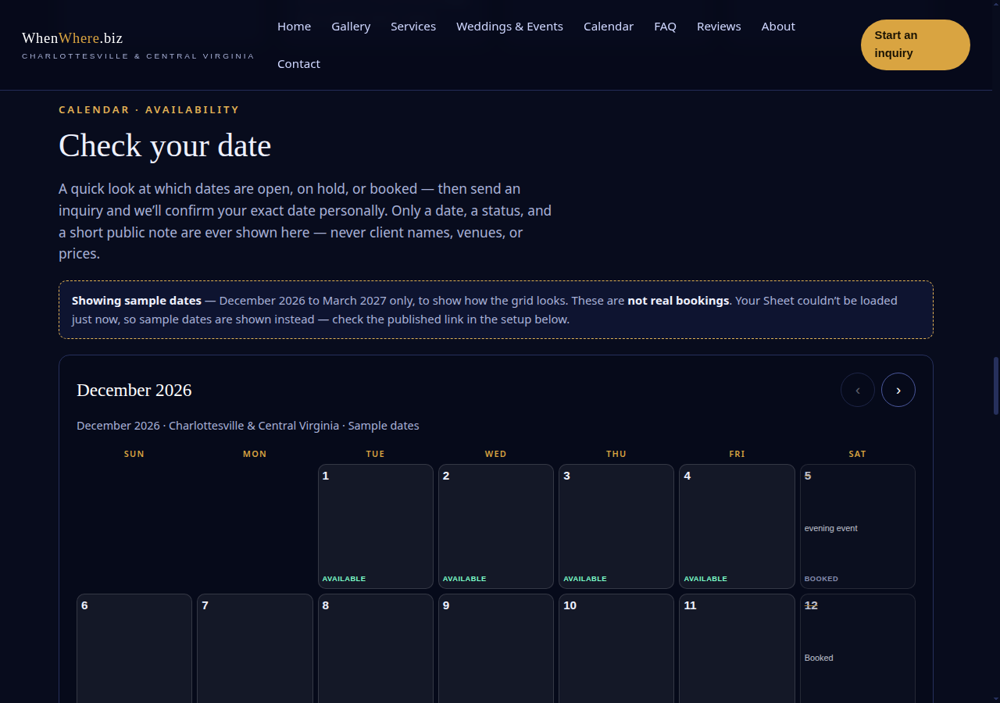

# WhenWhere.biz — Main Site

The main site for WhenWhere.biz: weddings & events plus drone light
shows, for Charlottesville and Central Virginia. It is the page the
drone light shows page links home to.

**Live:** <https://enonymous1.github.io/whenwhere-biz-main-site/>
— GitHub Pages, deployed from this repo (see [Deployment](#deployment)).

## What is on the page

- **One theme — Night & Gold** — night navy `#060a1a` + gold
  `#d9a441`, the same design system as the drone light shows page.
  There is no theme picker; the Sunset Peach theme was removed.
- **The intro, verbatim** — "At WHEN & WHERE, our goal is to provide
  the heart beat to your celebration… an evening that will resonate
  for a lifetime." It sits under the hero.
- **Sections for every nav link** — Home, Gallery, Services, Weddings
  & Events, Calendar, FAQ, Reviews, About, Contact. Gallery reuses the
  site's existing photos.
- **Drone light shows** — a featured lane with a live canvas sky that
  cycles hearts → rings → starburst, linking out to
  <https://enonymous1.github.io/whenwhere-drone-light-shows/> (the
  drone page's own home; it moves to whenwhere.biz/drone-light-shows/
  when the full site does).
- **About** — About Us, Our Story, and Meet The Team. The team cards
  are placeholders until real names and photos are added.
- **Calendar — Option A, Sheets-driven** — a month grid in the site's
  own style showing Available / Hold / Booked, with a legend. Tap a
  date for its detail, then “Check this date” prefills the inquiry
  form with that date. It reads the published Google Sheet CSV live
  (`SHEET_CSV_URL` is set — see
  [Calendar & form setup](docs/CALENDAR-AND-FORM-SETUP.md)); if the
  Sheet cannot be loaded it falls back to clearly-labelled sample
  dates for Dec 2026–Mar 2027 and says so. Seasonal lead-time
  guidance sits below the grid.
- **One shared inquiry form** — lane buttons pre-fill it (wedding date
  check, drone 2027 date), and tapping a calendar date prefills the
  event date. It is connected (`INQUIRY_ENDPOINT` is set): submitting
  saves the inquiry to a private Google Sheet and emails your personal
  Gmail (Apps Script — see the setup guide); you reply from that
  personal email. If the endpoint were ever unset, the fallback is
  copy / download only — there is no mailto, and no email address is
  listed anywhere on the page.

Honest placeholders, kept on purpose: Reviews is a "reviews on their
way" placeholder rather than invented testimonials, and the team cards
carry no invented names or photos. The calendar's sample dates are
labelled sample-only — they are not real bookings.

## Screenshots

Captured from the page at 1280×900 in dark mode (the page follows the
OS; the shots below are the dark rendering, which is where the themed
scrollbar shows). The hero is a plain viewport screenshot of the top
of the page; the section shots scroll the section into view first —
for sections with no top padding, leave room for the sticky nav or
the heading hides behind it. Serve the folder over HTTP first so the
photos and fonts load.




## Preview

`index.html` plus the `assets/` photos beside it — open it in a
browser, or serve the folder so paths resolve exactly as they will on
Pages:

```bash
python3 -m http.server 8000
# open http://localhost:8000
```

## Calendar & form setup

Full step-by-step instructions — public Sheet, private Sheet, Apps
Script deployment, testing, and troubleshooting — are in
[docs/CALENDAR-AND-FORM-SETUP.md](docs/CALENDAR-AND-FORM-SETUP.md).
The short version: create the two Sheets, publish the public one as
CSV, paste its link as `SHEET_CSV_URL` and the Apps Script Web app
URL as `INQUIRY_ENDPOINT` in `WHENWHERE_CONFIG` at the top of the
calendar script in `index.html`, push once. After that, editing the
Sheet updates the calendar with no redeploy.

## Deployment

Hosted on GitHub Pages via GitHub Actions — free, fast, versioned in
git, and no backend server needed. The workflow
(`.github/workflows/pages.yml`) deploys the page on every push to
`main`. There is no build step: what is committed is what goes live.

**One-time setup:**

1. Create an EMPTY public repo, e.g.
   `enonymous1/whenwhere-biz-main-site`.
2. Upload this folder's contents (including `.github/` and `docs/`)
   to its root.
3. Repo → **Settings → Pages → Build and deployment → Source: GitHub
   Actions** → Save. (Not "Deploy from a branch".)
4. Push to `main`. Watch the run under the repo's **Actions** tab;
   it takes ~1–2 minutes. The live URL is
   `https://enonymous1.github.io/whenwhere-biz-main-site/` — that is
   the link to share for the demo.

**Updating the page:** small copy changes can be edited directly in
`index.html` and pushed. Bigger changes (new sections, theme work)
go through the WhenWhere.biz Main Site build and are re-exported
over `index.html`, then pushed the same way. Calendar date changes
do not need a push at all once the Sheet is connected — edit the
Sheet. Note: the Sunset Peach theme and theme picker were removed
from this repo on 2026-11-17; if the page is ever re-exported from
the build, that removal has to be re-applied to the export.

When the full site is ready, this page is the one that moves to
`whenwhere.biz` itself — the drone page already links home to it.

## Project structure

```text
whenwhere-biz-main-site/
├── .github/
│   └── workflows/
│       └── pages.yml           # deploy on push to main
├── docs/
│   ├── CALENDAR-AND-FORM-SETUP.md   # Sheets + Apps Script setup, testing, troubleshooting
│   ├── calendar-sample.csv          # the 14 sample dates shown before setup
│   ├── screenshots/                 # hero, drone section, calendar (for this README)
│   │   ├── hero.jpg
│   │   ├── drones.png
│   │   └── calendar.png
│   └── apps-script/
│       └── Code.gs                  # Apps Script doPost for the private Sheet
├── index.html                  # the page
├── assets/                     # photos (hero, barn, ceremony, dancing, drone-hearts)
├── README.md
└── LICENSE                     # © 2026 WhenWhere.biz, all rights reserved
```

## License

© 2026 WhenWhere.biz — All rights reserved. See `LICENSE`.
