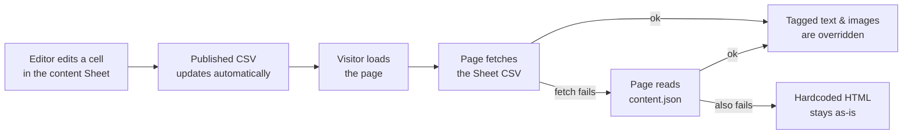
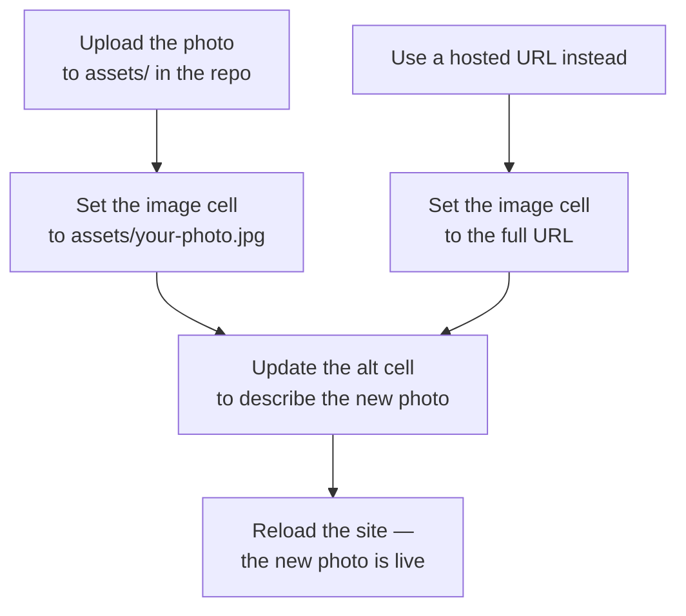
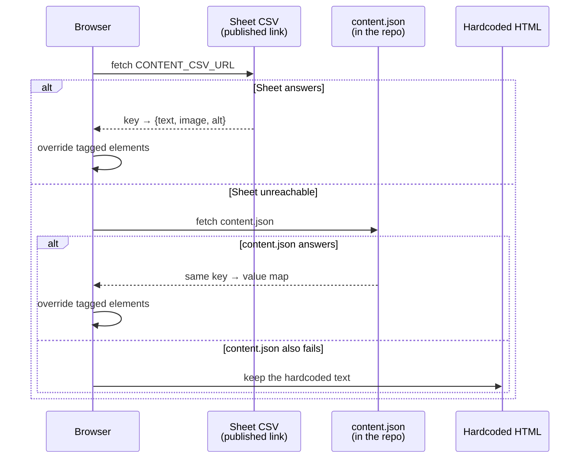

# Editing the site content — main site

How to change the words and photos on the WhenWhere.biz main site
without touching code. Written for two sets of eyes: the **editor**
(the person updating copy and photos) and the **manager/developer**
(the person who owns the repo and the Sheet).

The short version: **the copy lives in a Google Sheet, not in the
code.** Edit a cell, save, reload the page — the change is live. No
push, no redeploy, no GitHub account needed for copy edits.

## How it works

Every bit of editable copy on the page is tagged with a **key** (for
example `hero-kicker`, `gallery-heading`, `faq-1-q`). The page reads
a table of those keys from a Google Sheet and swaps the matching text
and images in. The text baked into `index.html` stays as the fallback,
so the page is never blank.

The content Sheet (published as CSV):

`https://docs.google.com/spreadsheets/d/e/2PACX-1vRfwoYY769Dq1nZCsXjmrVYnlJyEsk6PMzQrqZZIDKivCES0Fj9ZiayJqI1JDsUWKoFbhKMI8TUDypk/pub?gid=0&single=true&output=csv`

The Sheet has four columns — `key | text | image | alt` — one row per
item. Text rows fill in `text`; image rows fill in `image` (a filename
in `assets/`, e.g. `assets/hero.jpg`, or a full URL) and `alt` (the
accessibility description — the words a screen reader reads for the
photo). Image size is set by the page's CSS, not the Sheet. There are
137 rows: 132 text items and 5 photos.

The page fetches with `no-store`, so an edit shows on the next load.
Google can take a few minutes to republish the CSV after an edit — if
a change doesn't appear at once, wait a few minutes and hard-refresh
(`Ctrl+Shift+R` / `Cmd+Shift+R`).

### The two Sheets — don't mix them up

This site has **two** Google Sheets, and they do different jobs:

| Sheet | What it holds | Who edits it |
|---|---|---|
| **Content Sheet** (this doc) | The words and photos on the page | Anyone with the link |
| **Public availability Sheet** | The calendar dates (`Date \| Status \| Note`) | The manager, for bookings |

The calendar reads the availability Sheet; everything else on the page
reads the content Sheet. A date change goes in the availability Sheet,
a wording change goes in the content Sheet.

## The editor's view — changing copy

### Find the row

Every row's `key` describes where it lives on the page:
`hero-kicker` is the small line above the hero headline,
`gallery-heading` is the gallery's heading, `faq-1-q` / `faq-1-a`
are the first FAQ question and answer, `team-1-name` is the first
team member's name. Use `Ctrl+F` / `Cmd+F` in the Sheet to find one.

### Edit text — worked example

Say the gallery heading should read "Nights we've lit up" instead
of "Nights we've lit":

1. Open the content Sheet, find the `gallery-heading` row.
2. Change its `text` cell to `Nights we've lit up`.
3. Save (the Sheet saves itself) and reload the site. Done — no push,
   no redeploy.

That's the whole workflow for any text row: find the key, edit the
cell, reload.

### Rules that will save you a headache

- **Blank cells are ignored.** Clearing a `text` cell does **not**
  clear the text on the page — the loader skips the blank cell and
  the old wording stays. To remove a line of copy entirely, ask the
  developer (the element itself has to come out of the page).
- **A few rows keep markup — keep their tags.** The hero headline and
  a handful of labels carry HTML in their `text` value. For example,
  `hero-headline` reads:

  `Tell us when. Tell us where. We’ll bring the night.`

  The `…` makes a word gold and ` ` is
  a line break. When you edit one of these rows, change the words but
  **keep the tags exactly as they are** — delete a ` ` and two
  lines collapse into one; delete a `` and the gold runs on
  into the next line. The rows with markup are: `hero-headline`,
  `manifesto-1`, `manifesto-2`, `drone-note`, `about-story-1`,
  `form-label-phone`, `form-label-date`, `form-label-venue`. Every
  other row is plain text — type normally.
- **Commas and quotes are fine.** The Sheet handles them; the page's
  CSV parser reads quoted values correctly. An apostrophe in "we've"
  is no problem.
- **Don't rename a key.** The page looks the row up by its key. Rename
  `gallery-heading` and the page stops finding it — the old hardcoded
  heading comes back and your new row is ignored.

### Name a team member — worked example

The three team members currently read "Name coming soon". To name
the first one:

1. Find the `team-1-name` row — its `text` is `Name coming soon`.
2. Change it to the person's name, and `team-1-role` to their role
   (e.g. `DJ & MC`).
3. Reload. Each member has their own keys (`team-1-name`,
   `team-2-name`, `team-3-name`), so they can be named independently.

## The editor's view — changing a photo

A photo is one row: `image` says which file to show, `alt` says what
it shows. There are two ways to point at a new photo.

### Option A — a file in the repo (recommended)

The photo lives in the site's `assets/` folder, versioned in git
alongside everything else.

1. Get the new photo ready — a JPEG, sensibly sized (the hero is
   shown full-width; a 1600px-wide file is plenty).
2. Upload it to `assets/` in the repo. In GitHub: open the repo →
   `assets/` → **Add file → Upload files** → drag the photo in →
   **Commit changes**. Name it clearly, e.g. `assets/hero-dusk.jpg`.
3. In the content Sheet, find the photo's row (for the hero, that's
   `img-hero`) and set its `image` cell to the filename:
   `assets/hero-dusk.jpg`.
4. Update the `alt` cell too — it should describe the **new** photo,
   not the old one. The current hero alt is: *"A Virginia vineyard
   estate glowing at dusk beneath the Blue Ridge mountains, set up
   for an evening celebration"*.
5. Reload the site. The new photo is live.

### Option B — a full URL

If the photo lives somewhere else on the web (a hosted image, a
public Drive link), put the full URL in the `image` cell instead of
a filename. The main site has no Content Security Policy, so any
URL the browser can reach will load. The trade-off: the image isn't
versioned with the site, and if the host moves or deletes it, the
page shows a broken image. Prefer Option A for photos that matter.

### Which photo is which

| Key | Where it shows |
|---|---|
| `img-hero` | The hero banner at the top of the page, and the gallery's hero tile (same photo, same key — swapping it updates both) |
| `img-barn` | The barn photo |
| `img-ceremony` | The ceremony photo |
| `img-dancing` | The dancing photo |
| `img-drone-hearts` | The drone-hearts photo in the drone section |

## What the page does on load

The fallback chain is why the page never goes blank: the Sheet is the
live source, `content.json` is the frozen copy from the last push, and
the hardcoded HTML is the last resort. `content.json` holds the same
137 keys as the Sheet, so the fallback looks identical — the only
difference is that edits made in the Sheet after the last push don't
show until the Sheet answers again.

## What's not in the Sheet

Some things are app behaviour, not copy, and stay in the code:

- **Nav labels** (Home, Weddings & Events, Drone Light Shows,
  Calendar, …) — structural.
- **The submit button and the form note** — the form's mode sets them
  in JS (the note changes depending on whether the inquiry endpoint
  is configured).
- **The send-failure result panel** and the **validation messages**
  ("Please enter your name", …) — dynamic, shown by the form.
- **The calendar's status strings** (Available / Hold / Booked) —
  generated from the availability Sheet.

To change one of those, or to add a new editable bit of copy, that's a
developer job: tag the element with `data-content="new-key"` (or
`data-content-img` for an image), add the row to the Sheet **and** to
`content.json`, and push. The loader picks the new key up with no
other code change.

## Troubleshooting

| Symptom | Likely cause | Fix |
|---|---|---|
| I edited a cell, the page still shows the old text | Google hasn't republished the CSV yet, or the browser cached the page | Wait a few minutes, then hard-refresh (`Ctrl+Shift+R`) |
| I edited a cell, the page shows the old text after an hour | The key was renamed, or the edit went in the wrong row | Check the `key` column — the page looks the row up by key, not by position |
| A line of text vanished / the gold ran on | A tag was deleted from an HTML row (`hero-headline`, `manifesto-1/2`, `drone-note`, `about-story-1`, the three `form-label-*` rows) | Restore the ``, `` or ` ` from `content.json` (it holds the last good values) |
| A photo shows as broken | The `image` cell points at a file that isn't in `assets/`, or a URL that moved | Check the filename spelling (`assets/hero.jpg`, not `hero.jpg`); re-upload the file if it's missing |
| Everything reverted to the old copy | The Sheet is unreachable (or its publish was turned off) and the page fell back to `content.json` | Check the Sheet is still published (File → Share → Publish to web) and the link in `CONTENT_CSV_URL` matches |
| I cleared a cell and the text is still there | That's by design — blank cells are ignored | Put the text you want in the cell; to remove the line entirely, ask the developer |

## Manager / developer routine

- **The Sheet is the live source.** Copy edits need no push and no
  redeploy. A push is only needed when the page itself changes (new
  sections, new keys, a new photo file in `assets/`).
- **Keep `content.json` in step.** It is the fallback, and it's what
  the page shows if the Sheet is unreachable. Whenever a batch of
  Sheet edits is done, copy the Sheet's current contents back into
  `content.json` (export the Sheet as CSV, or copy
  `docs/content.csv` — the repo holds the same table) and push, so
  the fallback never goes stale.
- **`docs/content.csv` is the Sheet's seed.** It's the table as of the
  last push. If the Sheet is ever lost, paste this file into a new
  Sheet, publish it, and put the new link in `CONTENT_CSV_URL` in
  `WHENWHERE_CONFIG` at the top of the script in `index.html`.
- **If the Sheet is re-published under a new link**, update
  `CONTENT_CSV_URL` in `index.html` and push — the page reads that
  one URL.
- **Adding a new editable bit:** tag the element, add the row to the
  Sheet and to `content.json`, push. The loader needs no code change.

## Automatic vs manual

| Step | Automatic | Manual |
|---|---|---|
| Edit text or a photo's `alt` in the Sheet | Published CSV updates; page picks it up on next load | Find the right row, type the new value |
| Swap a photo to a repo file | Page shows it once the cell points at it | Upload the file to `assets/`, update the `image` cell |
| Swap a photo to a URL | Page shows it once the cell points at it | Paste the URL in the `image` cell |
| Add a new editable section | Nothing — it's a code change | Tag the element, add the row to Sheet + `content.json`, push |
| Sheet unreachable | Page falls back to `content.json`, then hardcoded HTML | Re-publish the Sheet or fix the link |
| New team member | Nothing — it's a Sheet edit | Change `team-N-name` and `team-N-role` |

## Gaps

- There is no history in the Sheet beyond Google's own version
  history (File → Version history) — if a bad edit goes in, restore
  the earlier version there.
- There is no preview: the only way to see an edit is to load the
  live page (or a local copy of the repo served over HTTP).
- `content.json` only updates when someone copies the Sheet back
  into the repo and pushes — it can drift behind the Sheet.
- A photo swap to a repo file needs a GitHub upload, which needs a
  GitHub account with write access — the one step in this doc that
  isn't Sheet-only.
