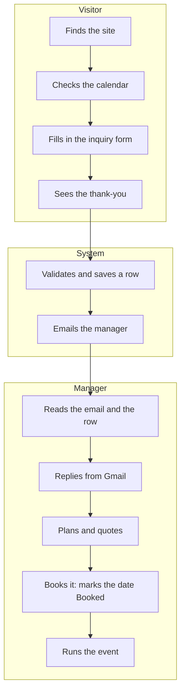
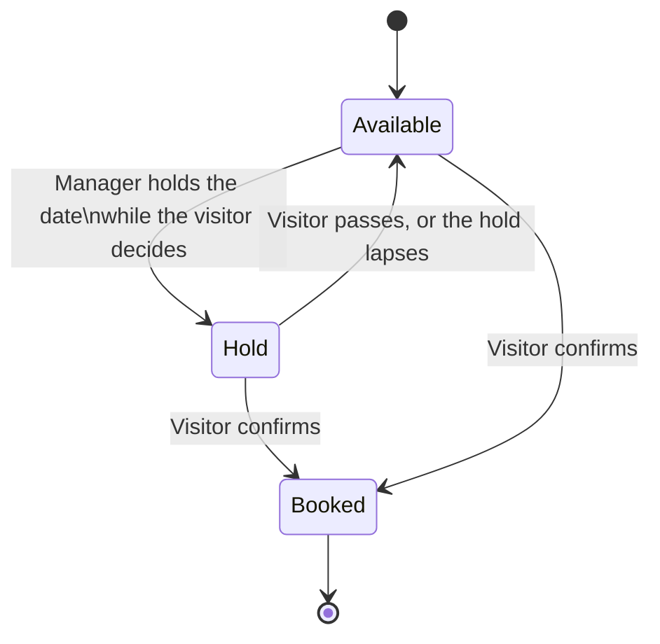
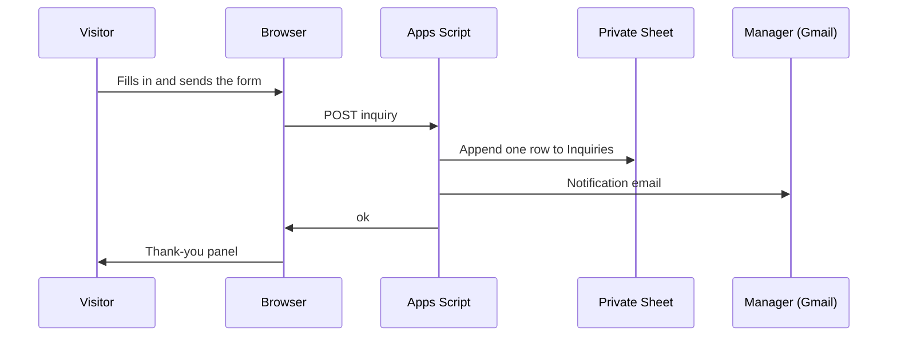

# When&Where.biz — Inquiry Pipeline & Workflow

**What this is:** the journey of one inquiry on the main site, from a visitor
finding the page to the event happening, told from both sides — what the
**visitor** sees and does, and what the **manager** (Justin) sees and does.

**Scope:** the main site only (weddings, DJ/MC, private events, vineyard
celebrations, corporate events, alumni events — and drone light shows that
arrive through the main form, type "Drone light show"). The drone site has
its own pipeline doc at
`whenwhere-drone-light-shows/docs/inquiry-pipeline.md`.

**What it is not:** a setup guide. Installing the Sheets and the Apps Script
is in `docs/CALENDAR-AND-FORM-SETUP.md`. This document assumes that setup is
done and describes the pipeline as it runs day to day.

> The diagrams below are Mermaid. They render as charts on GitHub; in a
> plain text editor they read as the code blocks they are.

---

## The pipeline at a glance

---

## Stage 0 — Setup (manager only, one time)

Before any of this works, the manager has already done the following
(once). The visitor never sees any of it.

| Manager does | Where |
|---|---|
| Creates the **public availability Sheet** — columns `Date \| Status \| Note` only. No client names, venues, prices, or contact details; the most it can ever reveal is that a date is booked. | Google Sheets, published to web as CSV |
| Creates the **private bookings Sheet** — e.g. `When&Where — Private Bookings`. Never published to web, shared only with people who should see client details. | Google Sheets |
| Pastes `docs/apps-script/Code.gs` into the private Sheet's Apps Script editor, sets `NOTIFY_EMAIL` to his personal Gmail, and deploys it as a web app (Execute as: Me, Who has access: Anyone). | Apps Script |
| Puts the web app URL in the site as `INQUIRY_ENDPOINT`. | `index.html` |
| Adds his own tabs alongside `Inquiries` in the private Sheet (e.g. `Bookings`, `Payments`). The script only ever touches `Inquiries`, so their headers are his to type. | Private Sheet |

---

## Stage 1 — Discover: "Is my date free?"

### Visitor

- Lands on the site, reads the services, looks at photos.
- Opens the **Calendar** and taps a date. The detail shows its status:
  **Available**, **Hold**, or **Booked**, plus any note (e.g. "Evening only").
- If the date is free, the visitor taps **"Check this date"** — it takes
  them to the inquiry form with that date prefilled.
- If the date is booked, they pick another date or ask anyway.
- The lane buttons (wedding date check, drone 2027 date) also prefill
  the form for that kind of event.

### Manager

- Keeps the public availability Sheet current. This is the only thing
  that makes the calendar truthful — nothing updates it automatically.
- To mark a date **Booked** or **Hold**: edit its `Status` cell in the
  public Sheet, then reload the site to check.
- To free a date again: delete its row (it defaults to Available) or
  set `Status` to `Available`.
- Dates must be `YYYY-MM-DD` and `Status` must be exactly `Available`,
  `Hold`, or `Booked` — a typo shows the wrong status on the site.

### How a date moves

### What the system does

- The calendar reads the public Sheet's CSV and renders each date's
  status. It never writes back to the Sheet.
- If the Sheet cannot be loaded, the calendar falls back to clearly
  labelled sample dates (Dec 2026–Mar 2027) and says so.

---

## Stage 2 — Inquire: the form

### Visitor

- Fills in the form. Required fields are name, email, and event type;
  the date is required unless they tick "My date is flexible".
- **Fields:** name, email, phone, event type, event date, venue/town,
  expected guests, budget, planning stage, and "About the night" (their
  dream for the event).
- **Event types:** Wedding, Private event, Vineyard / winery
  celebration, Corporate / brand event, Alumni / university event,
  Drone light show, Venue or planner — partnership, Something else.
- **Date rule the visitor feels:** the earliest date is today.
- Hits **Send**. If something required is missing, the form flags that
  field and nothing is sent.
- Sees a **thank-you panel**: "Thank you — your inquiry is in."
- **The visitor gets no confirmation email.** The thank-you panel is
  the only confirmation. If the send itself fails, the form shows the
  inquiry text with copy/download buttons so they can send it another
  way.
- If they submit the same inquiry twice within 5 minutes (same email +
  same date), the second copy is silently dropped — no second row, no
  second email — but the form still shows the thank-you. A different
  date, or waiting 5 minutes, goes through.

### What the system does (automatic)

1. Validates the fields in the browser.
2. POSTs the inquiry to the Apps Script endpoint.
3. The script appends one row to the private Sheet's `Inquiries` tab —
   11 columns: `Submitted | Name | Email | Phone | Type | Date | Venue |
   Guests | Budget | Stage | Dream/notes`.
4. The script writes the header row itself, once, when the tab is
   empty. If the tab already has rows with no headers, the manager
   inserts the header row by hand (right-click row 1 → Insert 1 row
   above).
5. The script emails the manager a notification (see Stage 3).
6. The script answers `ok`, and the form shows the thank-you.

### Manager

- Does nothing at this stage — the row and the email arrive on their
  own. (Unless the visitor calls or messages separately, which is
  outside this pipeline.)

---

## Stage 3 — Respond: the manager's inbox

### Manager

- Gets a **notification email** at his personal Gmail for every
  inquiry. Subject: `New When&Where inquiry — {type}`.
- The email lists every field the visitor entered, and ends with a
  **"View all inquiries in the private Sheet"** link that opens the
  spreadsheet at the `Inquiries` tab — one click shows the full history
  around the row that just landed.
- Opens the Sheet (or clicks the link in the email) and reads the row.
- **Replies from his personal Gmail** — the same address the
  notification came to — using the same signature every time. The
  stated aim is a reply within two working days.
- If the inquiry is thin (no venue, no date, "just curious"), the reply
  asks the missing questions.

### Visitor

- Waits. The first thing they hear back is the manager's personal
  reply — there is no automated "we got it" email, so the two-working-day
  reply is the moment the pipeline feels alive to them.
- Replies with the details the manager asked for.

### What the system does

- Nothing beyond the notification email. There is no auto-reply, no
  read receipt, and no reminder if the manager hasn't answered yet.

---

## Stage 4 — Plan & quote

### Visitor

- Trades messages with the manager: pins down the date, the venue, the
  package, the guest count, and what they want from the night.
- Gets a price / package proposal and decides.

### Manager

- Checks the public availability Sheet before promising a date — if
  another inquiry is already circling the same date, he decides who
  gets it and can put the date on **Hold** in the public Sheet while
  the visitor decides.
- Confirms the package and the price, and records the working details
  in the private Sheet (his own `Bookings` tab, or notes against the
  inquiry row — whichever he chooses; the script doesn't do this part).
- If the visitor goes quiet, the follow-up is his to send. Nothing
  chases them automatically.

### What the system does

- Nothing. This stage is entirely people talking to people.

---

## Stage 5 — Book

### Visitor

- Confirms the date, the package, and the price.
- Pays whatever deposit / payment the manager asks for (how payment is
  taken is outside this pipeline — see "Gaps & decisions").

### Manager

- **Marks the date Booked in the public Sheet** (`Status` → `Booked`),
  so the calendar stops offering it. Reloads the site to check.
- Records the booking in the private Sheet — the `Bookings` tab with
  client name, venue, package, price, and payment status — and the
  payment in the `Payments` tab.
- Confirms back to the visitor from personal Gmail: date, package,
  price, what's next.

### What the system does

- Nothing. The calendar only changes because the manager edited the
  public Sheet.

---

## Stage 6 — Deliver & close out

### Visitor

- The event happens.
- Afterwards, the manager may ask for feedback or photos.

### Manager

- Runs the event.
- Marks the booking done in the private Sheet (`Bookings` / `Payments`
  tabs), so the history is complete.
- If the date was a one-off, nothing further is needed — the public
  Sheet row stays `Booked` as part of the history.
- Keeps any photos or feedback the visitor shares for the site's
  gallery (with their permission).

---

## What is automatic, and what is manual

| Step | Automatic | Manual (manager) |
|---|---|---|
| Calendar shows a date's status | Reads the public Sheet CSV | Editing the public Sheet to set Available / Hold / Booked |
| Form validation + spam guard | Browser + script (5-min same email+date) | — |
| Row saved to `Inquiries` | Script appends it + writes the header once | Inserting the header by hand if the tab already had rows |
| Manager notified | Email to `NOTIFY_EMAIL` on every submit, with a link to the Sheet | Reading it and replying |
| Visitor confirmed | Thank-you panel only | — (no confirmation email is sent) |
| Reply to the visitor | — | From personal Gmail, same signature, ~2 working days |
| Hold / Book a date | — | Edit `Status` in the public Sheet |
| Record the booking + payment | — | `Bookings` / `Payments` tabs in the private Sheet |
| Follow-up if the visitor goes quiet | — | Manager sends it |
| Close out after the event | — | Mark done in the private Sheet |

---

## The manager's routine

**When a notification email arrives:**
1. Read the email (or click its Sheet link).
2. Read the row in the `Inquiries` tab.
3. Reply from personal Gmail — same signature, within two working days.
4. If the date is in play, consider putting it on **Hold** in the public Sheet.

**When a booking is confirmed:**
1. Set the date to **Booked** in the public Sheet. Reload the site to check.
2. Add the booking to the private Sheet's `Bookings` tab; record payment in `Payments`.
3. Confirm back to the visitor.

**Weekly (or when the calendar looks stale):**
1. Skim the `Inquiries` tab for anything unanswered.
2. Check the public Sheet's statuses against the private Sheet's bookings — they should agree.

---

## Gaps & decisions (what the pipeline does not do yet)

These are things the system does **not** do today. Each is a decision,
not a bug — but they are the places where the pipeline leans on the
manager's memory.

1. **No confirmation email to the visitor.** The visitor only sees the
   thank-you panel. If a "we got it, we'll reply within two working
   days" email would help, that's a new script feature (send a second
   email to the visitor's address).
2. **No pipeline status column.** The `Inquiries` tab records what the
   visitor submitted — including the stage *they* picked (Ready to
   book / Planning ahead / Just curious). It does not track the
   manager's stage (contacted → quoted → booked → done). Tracking that
   means adding a column to `Inquiries` (e.g. `Status`) or running it
   through the `Bookings` tab.
3. **One notification address.** `NOTIFY_EMAIL` is a single personal
   Gmail. A second recipient (e.g. James) would mean a second address
   in the script.
4. **No automated follow-up or reminder.** If the manager hasn't
   replied, or a visitor goes quiet after a quote, nothing nudges
   anyone.
5. **No payment step in the pipeline.** The private Sheet has a
   `Payments` tab to record payments, but how a deposit is taken
   (link, invoice, bank transfer) is not part of the system.
6. **The public calendar is only as current as the manager's last
   edit.** Nothing warns the manager if a booked date is still showing
   Available.

---

## One-page summary

| Stage | Visitor | System (automatic) | Manager |
|---|---|---|---|
| Discover | Browses, checks the calendar | Calendar reads the public Sheet | Keeps the public Sheet current |
| Inquire | Fills + sends the form | Validates, saves a row, emails the manager | — |
| Respond | Waits | — | Reads the email/row, replies from Gmail (~2 days) |
| Plan & quote | Shares details, picks a package | — | Checks availability, quotes, may Hold the date |
| Book | Confirms, pays | — | Marks the date Booked, records booking + payment |
| Deliver | The event happens | — | Runs it, closes it out in the private Sheet |
